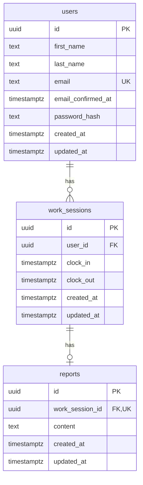

# Data model

Draft. This describes the tables of Apprentice Clock: each column with its type and constraints. Types are PostgreSQL types.

## `users`

One row per person who uses the app.

| Column | Type | Constraints | Notes |
| --- | --- | --- | --- |
| `id` | `uuid` | primary key | Not guessable, can be generated outside the database. |
| `first_name` | `text` | `NOT NULL` | |
| `last_name` | `text` | `NOT NULL` | |
| `email` | `text` | `NOT NULL`, `UNIQUE` | Used to log in. |
| `email_confirmed_at` | `timestamptz` | nullable | When the address was confirmed. `NULL` until the user confirms it. |
| `password_hash` | `text` | `NOT NULL` | Never the password itself, only a hash of it. |
| `created_at` | `timestamptz` | `NOT NULL` | Set when the row is created. |
| `updated_at` | `timestamptz` | `NOT NULL` | Changes every time the row is updated. |

### Why a password hash

The server never stores the password, only a hash of it. At login it hashes what the user typed and compares the two hashes. If the database leaks, attackers get hashes, not the passwords. A hash is one-way, so attackers can only guess and hash each guess. A slow, salted algorithm (bcrypt or argon2) makes that guessing expensive. The algorithm is `bcrypt`, with salt and cost stored inside the hash string (for example `$2b$12$...`).

### Open points

- Decided: the application generates the `id` (`uuid4`) and sets `created_at` and `updated_at` (in UTC), like learnOS does. `updated_at` is set again by the ORM on every update. Rows inserted by hand in `psql` are not a use case, so no database defaults are needed. Consequence: a manual `UPDATE` in `psql` does not change `updated_at`.
- Decided: all timestamps use `timestamptz`, not `timestamp`. `timestamptz` stores a precise moment (converted to UTC), so it means the same thing in every time zone. A plain `timestamp` only stores the clock time without a zone, so it is unclear which moment it means. The same applies to `clock_in` and `clock_out`: hours worked is the difference between two moments, and with `timestamptz` that stays correct across time zones and summer time changes.
- Decided: emails are compared case-insensitively by lowercasing (and trimming whitespace) in the application before saving. Postgres does not do this itself, so every code path that saves an email must do it, otherwise the `UNIQUE` constraint would treat `Anna@example.com` and `anna@example.com` as different users.

- Decided: `email_confirmed_at` was added in the second migration (`add_email_confirmed_at_to_users`). Nothing sets it yet: registration leaves it `NULL`. Confirming addresses comes in a later week, together with the confirmation email.

## `work_sessions`

One row per work session: one clock-in and, when the session ends, one clock-out. A user can have many sessions, also several on the same day (for example one before and one after the lunch break). The report of a session is in its own table, `reports`.

| Column | Type | Constraints | Notes |
| --- | --- | --- | --- |
| `id` | `uuid` | primary key | |
| `user_id` | `uuid` | `NOT NULL`, foreign key to `users.id` with `ON DELETE CASCADE` | Whose session this is. |
| `clock_in` | `timestamptz` | `NOT NULL` | When the session started. |
| `clock_out` | `timestamptz` | nullable | `NULL` while the session is open. |
| `created_at` | `timestamptz` | `NOT NULL` | Set when the row is created. |
| `updated_at` | `timestamptz` | `NOT NULL` | Changes every time the row is updated. |

Index: a partial unique index on `user_id` where `clock_out IS NULL`. See "One open session per user" below.

### Why `created_at` and `updated_at` here

Hours worked are calculated from `clock_in` and `clock_out`, not from these two columns. They record when the row was created and last changed. They match the `users` table (and the shared mixin), and `updated_at` gives an audit trail if a session is corrected later, for example to fix a forgotten clock-in.

### Rules

- One user has many sessions (one-to-many). Each session belongs to exactly one user.
- A session is open when `clock_out IS NULL`. It stays open until the user clocks out. Nothing runs on the server while it is open; it is only a row.
- A user has at most one open session at a time.
- Clock-in creates a new row. Clock-out updates the open row of the user and creates its report. See "Clock-out" below.

### One open session per user

Two clock-in requests can arrive at the same moment (a double click). If the API only looks up an open session and then inserts, both requests can find none and both insert, and the user ends up with two open sessions. A check in the API code alone cannot prevent this, because the lookup and the insert are two separate steps.

So the database enforces the rule too: a partial unique index on `user_id` that only covers rows where `clock_out IS NULL`. Among the open sessions each `user_id` can appear only once. Closed sessions are not in the index, so a user can have any number of them.

The API still checks first, so the normal case gets a clear error without hitting the index. If the index rejects an insert anyway (the double click), the API catches the integrity error and answers the same way. Both cases return `409 Conflict` with `already clocked in`.

## `reports`

One row per report. Every work session gets exactly one report, written at its clock-out. While a session is open it has no report yet.

| Column | Type | Constraints | Notes |
| --- | --- | --- | --- |
| `id` | `uuid` | primary key | |
| `work_session_id` | `uuid` | `NOT NULL`, `UNIQUE`, foreign key to `work_sessions.id` with `ON DELETE CASCADE` | The session this report belongs to. |
| `content` | `text` | `NOT NULL` | What was done in the session. |
| `created_at` | `timestamptz` | `NOT NULL` | Set when the row is created. |
| `updated_at` | `timestamptz` | `NOT NULL` | Changes every time the row is updated, for example when the report is corrected. |

### Rules

- One session has zero or one report (one-to-one). It has zero while the session is open and one after the clock-out. The `UNIQUE` constraint on `work_session_id` makes sure a session can never get a second report, even if the API has a bug. Postgres builds an index for every `UNIQUE` constraint, so `work_session_id` is indexed without an extra statement.
- A report has no `user_id`. Who owns a report is found through its session: take `work_session_id`, look up the session, and read its `user_id`. This is one join per ownership check, and nothing is stored twice, so the two values can never disagree. The cost of the join does not matter at this size.
- Deleting a session deletes its report (`ON DELETE CASCADE`). Deleting a user deletes their sessions and, through them, all their reports.

### Clock-out

Every clock-out needs a report. This rule spans two tables, so a `CHECK` constraint cannot enforce it: a `CHECK` only sees the row it belongs to. The service does both writes in one database transaction:

1. Set `clock_out` on the open session.
2. Insert the report for that session.
3. `commit()` once at the end.

If any step fails, the service rolls back, and neither change is saved. A session with `clock_out` set but without a report cannot be left behind by a half-finished request. The transaction lives in the service (like the commit and rollback in the auth service), not in the router.

### Daily report

There is no daily report table. Every session has its own report, written at its own clock-out. A daily report is built when reading: take all sessions of one user on one day and put their reports together in clock-in order.

## Open points

- Decided: the foreign key `work_sessions.user_id` uses `ON DELETE CASCADE`. When a user deletes their account, Postgres deletes all their sessions too, and their reports with them. At the start the app is only for the apprentice, not for a company, so the data belongs to the apprentice and does not have to be kept anywhere else. This replaces the first decision (`RESTRICT`), which was changed after the review by Max. Trade-off: a wrong `DELETE` on `users` really wipes someone's hours and reports, so deleting a user must only happen through a deliberate "delete my account" action. `SET NULL` does not work with `NOT NULL`.
- Not planned: a soft delete (for example a `deleted_at` column on `users`), because deleting an account should really remove the data. This can be revisited if a company needs to keep the training log.
- Decided: sessions and reports are two tables, linked one-to-one through `reports.work_session_id`. The report belongs to its session, not to the day. That allows several sessions per day, each with its own report, and a report can be created, read, changed and deleted as its own resource in the API.
- Decided: no `CHECK` constraint for "clock-out requires a report". A `CHECK` cannot see another table. The rule is enforced by the service with one transaction (see "Clock-out"). What counts as a valid report (for example a minimum length) is a product decision that belongs in the API.
- Decided: the owner of a report is found through a join over its session. `reports` has no `user_id` column.
- Open: deleting a report. If a report can be deleted on its own, a closed session is left without a report, which breaks "every clock-out needs a report". Options: do not allow deleting a report of a closed session, allow it and accept sessions without a report, or only delete reports together with their session. A product decision, to ask Max.
- Open: creating a report. The report is created together with the clock-out, in the same transaction. Does the API still need a separate `POST` for reports, or only `PATCH` and `DELETE` for existing ones? This changes the endpoint list for the create and list issue.
- Open: forgotten clock-outs. A session that is never closed blocks the next clock-in. An automatic clock-out at midnight would have no report, which breaks the "every clock-out needs a report" rule. Options: close it without a report, close it with a placeholder text, or let the user or an admin correct it the next day. A product decision, to ask Max.
- Open: `clock_out` before `clock_in`. Nothing stops it yet. Should the API prevent it, or the database with a `CHECK (clock_out >= clock_in)`? This one compares two columns of the same row, so a `CHECK` could do it.
- Open: an index for listing sessions. The partial unique index only covers open sessions. Listing all sessions of a user, newest first, may need a normal index on `user_id` (and `clock_in`).
- Open: the time zone for "same day" when building the daily report. 23:30 in Berlin is already the next day in UTC. Only matters for display, not for the database.

## ER diagram

