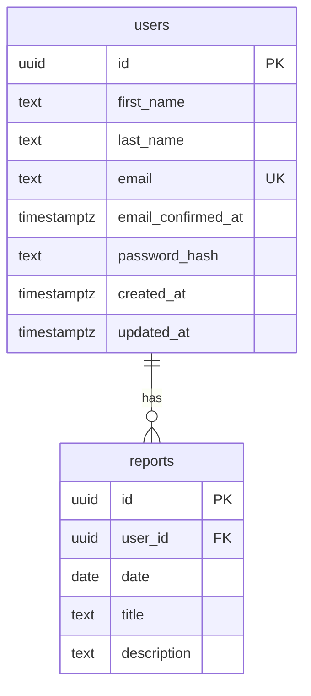

# Data model

Draft. This describes the tables of Apprentice Clock: each column with its type and constraints. Types are PostgreSQL types.

## `users`

One row per person who uses the app.

| Column | Type | Constraints | Notes |
| --- | --- | --- | --- |
| `id` | `uuid` | primary key | Not guessable, can be generated outside the database. |
| `first_name` | `text` | `NOT NULL` | |
| `last_name` | `text` | `NOT NULL` | |
| `email` | `text` | `NOT NULL`, `UNIQUE` | Used to log in. |
| `email_confirmed_at` | `timestamptz` | nullable | When the address was confirmed. `NULL` until the user confirms it. |
| `password_hash` | `text` | `NOT NULL` | Never the password itself, only a hash of it. |
| `created_at` | `timestamptz` | `NOT NULL` | Set when the row is created. |
| `updated_at` | `timestamptz` | `NOT NULL` | Changes every time the row is updated. |

### Why a password hash

The server never stores the password, only a hash of it. At login it hashes what the user typed and compares the two hashes. If the database leaks, attackers get hashes, not the passwords. A hash is one-way, so attackers can only guess and hash each guess. A slow, salted algorithm (bcrypt or argon2) makes that guessing expensive. The algorithm is `bcrypt`, with salt and cost stored inside the hash string (for example `$2b$12$...`).

### Open points

- Decided: the application generates the `id` (`uuid4`) and sets `created_at` and `updated_at` (in UTC), like learnOS does. `updated_at` is set again by the ORM on every update. Rows inserted by hand in `psql` are not a use case, so no database defaults are needed. Consequence: a manual `UPDATE` in `psql` does not change `updated_at`.
- Decided: all timestamps use `timestamptz`, not `timestamp`. `timestamptz` stores a precise moment (converted to UTC), so it means the same thing in every time zone. A plain `timestamp` only stores the clock time without a zone, so it is unclear which moment it means.
- Decided: emails are compared case-insensitively by lowercasing (and trimming whitespace) in the application before saving. Postgres does not do this itself, so every code path that saves an email must do it, otherwise the `UNIQUE` constraint would treat `Anna@example.com` and `anna@example.com` as different users.

- Decided: `email_confirmed_at` is nullable. Nothing sets it yet: registration leaves it `NULL`. Confirming addresses comes in a later week, together with the confirmation email.

## `reports`

One row per report: what a user did on one day, with a title and a description. A user writes at most one report per day. There is no time tracking for now (no clock-in or clock-out).

| Column | Type | Constraints | Notes |
| --- | --- | --- | --- |
| `id` | `uuid` | primary key | |
| `user_id` | `uuid` | `NOT NULL`, foreign key to `users.id` with `ON DELETE CASCADE` | Whose report this is. |
| `date` | `date` | `NOT NULL` | The day the report is about. Chosen and sent by the client. |
| `title` | `text` | `NOT NULL` | A short heading for the day. |
| `description` | `text` | `NOT NULL` | What was done. May be an empty string. |

Constraint: `UNIQUE (user_id, date)`. One report per user per day. See "One report per day" below.

### Why no separate index on `user_id`

Postgres builds an index for every unique constraint. The index of `UNIQUE (user_id, date)` is sorted by `user_id` first and then by `date`. So it also serves lookups by `user_id` alone, for example "all reports of a user", and the list of a user's reports newest first. A second index on `user_id` would only be a smaller copy of it. This only works because `user_id` is the first column of the constraint.

### Why a `date` and no time zone

`date` is a calendar day, not a moment, so it has the type `date`, which has no time and no time zone. The client says which day the report is about, and the server stores it as it is. The server never has to decide what "today" means, so no time zone is needed anywhere in the app. The date is required, so there is no default to guess.

### Why no `created_at` and `updated_at`

A report is a text about one day. Nothing in the app needs to know when a row was written or changed. Consequence: there is no record of when a report was created or edited. If that becomes important (for example when time tracking comes later), the columns can be added through a migration.

### Rules

- One user has many reports (one-to-many), at most one per day. Each report belongs to exactly one user.
- The owner is the logged-in user, taken from the token, never from the request body.
- The `title` is required and must not be empty after trimming whitespace. The `description` may be empty.
- A report can be read, changed (all fields, including the date) and deleted by its owner only.

### One report per day

The rule "once per day" is enforced by the database with `UNIQUE (user_id, date)`. The API checks first and answers `409 Conflict` when the user already has a report for that date. Two create requests can arrive at the same moment (a double click), and then both can pass the check of the API, because the lookup and the insert are two separate steps. The constraint rejects the second insert, and the API catches the integrity error and answers the same way.

## Open points

- Decided: the foreign key `user_id` uses `ON DELETE CASCADE`. When a user deletes their account, Postgres deletes all their reports. At the start the app is only for the apprentice, not for a company, so the data belongs to the apprentice and does not have to be kept anywhere else. Trade-off: a wrong `DELETE` on `users` really wipes someone's reports, so deleting a user must only happen through a deliberate "delete my account" action.
- Not planned: a soft delete (for example a `deleted_at` column on `users`), because deleting an account should really remove the data. This can be revisited if a company needs to keep the training log.
- Decided: the app starts with reports only and no time tracking. The first design had a `work_days` table with `clock_in`, `clock_out` and the report in one row. After the review by Max (PR #26) it was dropped: it was too complicated for a first version and did not lend itself to being changed later. Time tracking can come back later as its own table, connected to reports. There is no real data yet, so the migrations were collapsed into one (`create users and reports tables`), and `work_days` no longer appears in `migrations/versions` (it stays in the Git history). Everyone with a local database resets it once (`docker compose down -v`). After the first real data exists, migrations are only added, never rewritten.
- Decided: the client sends `date`, and it is required. This avoids a server time zone and a "today" default. A report for a day in the future is not refused for now. This can be revisited if it causes problems.
- Decided: one report per day, with `UNIQUE (user_id, date)`. Several reports on the same day are not possible in the first version.
- Decided: the column is called `date`, without a prefix like `report_`. The table is already called `reports`, so the prefix would say "report" twice (like `first_name` in `users`, not `user_first_name`). After the review by Max. `date` is also the name of a SQL type, but PostgreSQL allows it as a column name. In Python the model needs `datetime.date` as the type, so the column name does not hide it.
- Decided: `title` and `description` have no maximum length for now. The `description` is `NOT NULL` and may be empty, so the client never has to handle `null` for it. The API treats a missing description as an empty one.
- Decided: no `CHECK` constraints for now. What counts as a valid title (not empty after trimming) belongs in the API, so the user gets a readable error.
- Decided: no `created_at` and `updated_at` on `reports`, see above.
- Decided: every field of a report can be changed, including `date`. A change of the date that collides with another report of that day (same user) is refused with `409`, because of `UNIQUE (user_id, date)`. The API checks first, and the constraint catches two requests at the same moment, like at create.

## ER diagram

