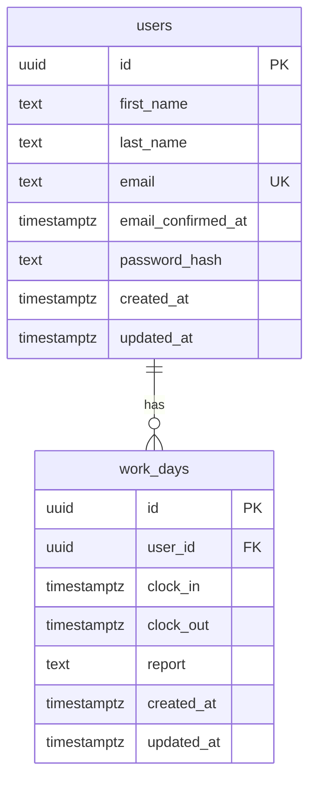

# Data model

Draft. This describes the tables of Apprentice Clock: each column with its type and constraints. Types are PostgreSQL types.

## `users`

One row per person who uses the app.

| Column | Type | Constraints | Notes |
| --- | --- | --- | --- |
| `id` | `uuid` | primary key | Not guessable, can be generated outside the database. |
| `first_name` | `text` | `NOT NULL` | |
| `last_name` | `text` | `NOT NULL` | |
| `email` | `text` | `NOT NULL`, `UNIQUE` | Used to log in. |
| `email_confirmed_at` | `timestamptz` | nullable | When the address was confirmed. `NULL` until the user confirms it. |
| `password_hash` | `text` | `NOT NULL` | Never the password itself, only a hash of it. |
| `created_at` | `timestamptz` | `NOT NULL` | Set when the row is created. |
| `updated_at` | `timestamptz` | `NOT NULL` | Changes every time the row is updated. |

### Why a password hash

The server never stores the password, only a hash of it. At login it hashes what the user typed and compares the two hashes. If the database leaks, attackers get hashes, not the passwords. A hash is one-way, so attackers can only guess and hash each guess. A slow, salted algorithm (bcrypt or argon2) makes that guessing expensive. The algorithm is `bcrypt`, with salt and cost stored inside the hash string (for example `$2b$12$...`).

### Open points

- Decided: the application generates the `id` (`uuid4`) and sets `created_at` and `updated_at` (in UTC), like learnOS does. `updated_at` is set again by the ORM on every update. Rows inserted by hand in `psql` are not a use case, so no database defaults are needed. Consequence: a manual `UPDATE` in `psql` does not change `updated_at`.
- Decided: all timestamps use `timestamptz`, not `timestamp`. `timestamptz` stores a precise moment (converted to UTC), so it means the same thing in every time zone. A plain `timestamp` only stores the clock time without a zone, so it is unclear which moment it means. The same applies to `clock_in` and `clock_out`: hours worked is the difference between two moments, and with `timestamptz` that stays correct across time zones and summer time changes.
- Decided: emails are compared case-insensitively by lowercasing (and trimming whitespace) in the application before saving. Postgres does not do this itself, so every code path that saves an email must do it, otherwise the `UNIQUE` constraint would treat `Anna@example.com` and `anna@example.com` as different users.

- Decided: `email_confirmed_at` was added in the second migration (`add_email_confirmed_at_to_users`). Nothing sets it yet: registration leaves it `NULL`. Confirming addresses comes in a later week, together with the confirmation email.

## `work_days`

One row per work day of a user: one clock-in and, when the day ends, one clock-out together with the report. A user can clock in and out once per day. The report is required to clock out, which is the core idea of the app.

| Column | Type | Constraints | Notes |
| --- | --- | --- | --- |
| `id` | `uuid` | primary key | |
| `user_id` | `uuid` | `NOT NULL`, foreign key to `users.id` with `ON DELETE CASCADE` | Whose work day this is. |
| `clock_in` | `timestamptz` | `NOT NULL` | When the work day started. The day of the work day is the day of this moment in the time zone `Europe/Berlin`. |
| `clock_out` | `timestamptz` | nullable | `NULL` while the work day is open. |
| `report` | `text` | nullable | `NULL` while the work day is open. Written together with `clock_out`. |
| `created_at` | `timestamptz` | `NOT NULL` | Set when the row is created. |
| `updated_at` | `timestamptz` | `NOT NULL` | Changes every time the row is updated. |

Index: a unique index on `user_id` and the day of `clock_in` in `Europe/Berlin` (an expression, not a column). One work day per user per day. See "One work day per day" below.

### Why no separate index on `user_id`

A unique index is sorted by its first column. The unique index above is sorted by `user_id` first and then by the day. So it also serves lookups by `user_id` alone, for example "all work days of a user", and the list of a user's work days newest first. A second index on `user_id` would only be a smaller copy of it. This only works because `user_id` is the first column of the index.

### Why `created_at` and `updated_at` here

Hours worked are calculated from `clock_in` and `clock_out`, not from these two columns. They record when the row was created and last changed. They match the `users` table, and `updated_at` gives an audit trail if a work day is corrected later, for example to fix a forgotten clock-in.

### Rules

- One user has many work days (one-to-many), at most one per day. Each work day belongs to exactly one user.
- A work day is open when `clock_out IS NULL`. It stays open until the user clocks out. Nothing runs on the server while it is open; it is only a row.
- Every clock-out needs a report. The API sets `clock_out` and `report` in the same update. One update of one row is atomic, so no transaction over several tables is needed.
- Clock-in creates a new row. Clock-out updates the open row of the user.
- Clocking in a second time on the same day is refused.
- A work day that is already closed cannot be clocked out again. `clock_out` must not be before `clock_in`.
- Clocking in while an older work day is still open is refused. The old work day must be closed first, with the real clock-out time and a report.

### One work day per day

The rule "once per day" needs a day to compare. A `timestamptz` is a moment, not a day. The day is part of `clock_in`, so there is no column for it: the database enforces the rule with a unique index on `user_id` and the day of `clock_in`, converted to the time zone `Europe/Berlin`. The API checks first and answers `409 Conflict` with `already clocked in`. Two clock-in requests can arrive at the same moment (a double click), and then both can pass the check of the API, because the lookup and the insert are two separate steps. The index rejects the second insert, and the API catches the integrity error and answers the same way.

The day depends on a time zone: 23:30 in Berlin is already the next day in UTC. That is why the index converts to `Europe/Berlin` before it takes the day. See the decision below.

### Daily report

There is no separate daily report. The report of the work day is the report of the day, because there is one work day per day. Downloading the reports (a feature of the first version) reads this column.

## Open points

- Decided: the foreign key `user_id` uses `ON DELETE CASCADE`. When a user deletes their account, Postgres deletes all their work days, and their reports with them. At the start the app is only for the apprentice, not for a company, so the data belongs to the apprentice and does not have to be kept anywhere else. This replaces the first decision (`RESTRICT`), which was changed after the review by Max. Trade-off: a wrong `DELETE` on `users` really wipes someone's hours and reports, so deleting a user must only happen through a deliberate "delete my account" action. `SET NULL` does not work with `NOT NULL`.
- Not planned: a soft delete (for example a `deleted_at` column on `users`), because deleting an account should really remove the data. This can be revisited if a company needs to keep the training log.
- Decided: the report is a column of `work_days`, not its own table. With one work day per day and one report per work day, a second table would only hold one more value of the same row. The report is not a separate resource in the API.
- Decided: one clock-in and one clock-out per day, with the report written at clock-out. This keeps the idea of the app (the report is a condition for clocking out). Several work periods per day (for example around a lunch break) are not possible in the first version.
- Decided: the table is called `work_days` (model `WorkDay`), because one row is one work day of a user. The name `work_sessions` was dropped, because "session" suggests several per day. The name `reports` was dropped, because the report is only one column of the row.
- Decided: no separate index on `user_id`, see "Why no separate index on `user_id`".
- Decided: no `CHECK` constraint for "clock-out requires a report" for now. The API enforces the rule first. What counts as a valid report (for example a minimum length) is a product decision that belongs in the API. Because the report is in the same row as `clock_out`, a `CHECK` such as `(clock_out IS NULL) = (report IS NULL)` would be possible later through a migration, as long as the existing data already follows the rule.
- Decided: forgotten clock-outs. A clock-in is refused while an older work day of the user is still open. The user first closes the old work day with the real clock-out time and a report, and only then can clock in. This keeps the rule "every clock-out needs a report" without exceptions and keeps the hours correct. Rejected: closing the old work day automatically at the next clock-in or at midnight. It would have no report, which is the problem the app exists to solve, and the real clock-out time is only known to the user (using "now" would add the night to the hours, a guess like midnight is wrong if the person left at 17:00). To confirm with Max.
- Decided: no partial unique index on `user_id` where `clock_out IS NULL` (at most one open work day per user) for now. The double click is already covered by the unique index on `user_id` and the day of `clock_in`. The API enforces "at most one open work day" with the check above. The index would only matter if two clock-ins on different days arrived at the same moment (around midnight), which is very unlikely. It can be added later through a migration if a bug shows that it is needed. To confirm with Max.
- Decided: one fixed time zone for the whole app, `Europe/Berlin`. The day of a work day is the day of `clock_in` in that zone. The unique index and the API use the same zone. Python's `zoneinfo` and Postgres handle the switch between summer and winter time. The day never changes afterwards, because `clock_in` is not changed: a work day that is closed on the next day keeps the day of its clock-in. The users are apprentices at German companies, so one zone fits the first version. If users in other time zones come later, a time zone per user can be added to `users`, and the index must be replaced through a migration, because the zone is written into it. To confirm with Max.
- Decided: no `work_date` column. It was in the first version, so the database could enforce "once per day" with a plain `UNIQUE (user_id, work_date)`. After the review by Max ("is this needed if we have the clock-in date time?") it was removed, because the day is part of `clock_in` and a second column could disagree with it. Trade-off: the unique index is an expression, which is harder to read and ties the time zone into the database; queries by day must convert `clock_in` to `Europe/Berlin` the same way.
- Decided: `clock_out` must not be before `clock_in`. The API checks it and answers `422` with a clear message. Nobody does it on purpose, but a user who closes a forgotten work day types the clock-out time by hand, and a typo (08:00 instead of 18:00) would give negative hours and wrong sums. There is no `CHECK (clock_out >= clock_in)` in the database for now: the API is the only way to write the row, and the user needs a readable error message anyway. Both columns are in the same row, so the `CHECK` can be added later through a migration, as long as the existing data already follows the rule.
- Decided: each work day has exactly one clock-out. Once `clock_out` is set, the row is closed and a second clock-out on it is refused. Closing a forgotten work day on the next day does not conflict with the rule "one clock-in per day": it updates the old row, while the new clock-in creates a different row with another day.

## ER diagram

